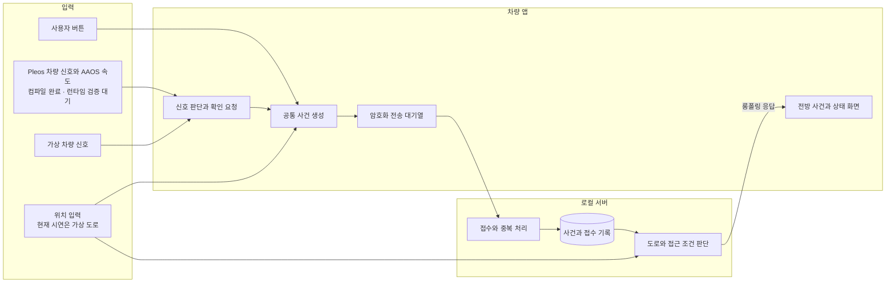
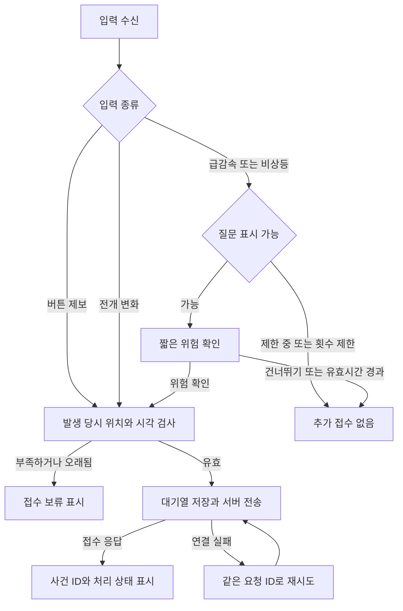
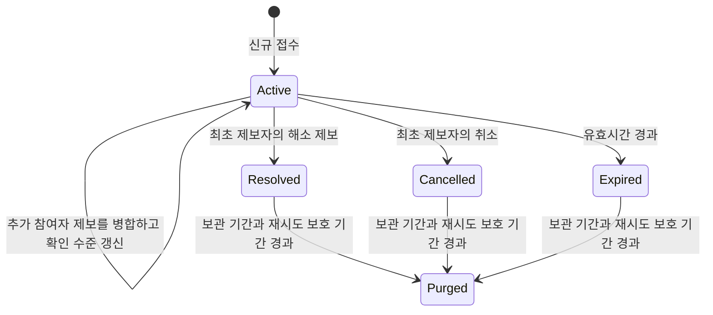
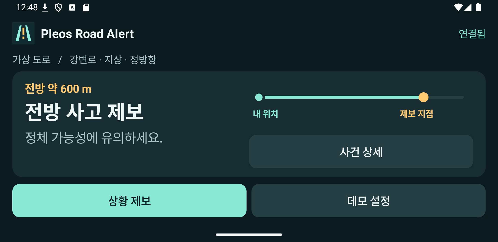

# Pleos Road Alert 앱 구동 기획

현대자동차그룹 차량용 앱 개발 공모전을 위한 사고·돌발상황 공유 앱의 제품 기획과 동작 기준이다. 기획 검토자와 개발자가 사용자 가치, 사건 처리 규칙, 현재 시연 가능한 범위, 다음 개발 과제를 함께 확인할 수 있도록 작성했다.

| 항목 | 내용 |
| --- | --- |
| 서비스 가칭 | Pleos Road Alert |
| 문서 버전 | 0.1 |
| 작성 기준일 | 2026년 11월 7일 |
| 현재 단계 | Android 앱과 로컬 서버를 연결한 프로토타입 |
| 확인한 실행 환경 | Windows, 일반 Android API 35 에뮬레이터, 별도 Python 참여자 |
| 다음 핵심 검증 | Pleos 전용 환경의 차량 신호 수신, 실제 도로 구간과 방향 연결 |

이 문서의 **구현**은 소스에 해당 경로가 있음을, **검증**은 실제 빌드·실행 또는 테스트 기록이 있음을 뜻한다. **추가 개발**과 **미확인** 항목은 후속 작업이다. 이전 실행 결과의 원본은 [검증 기록](../docs/VERIFICATION.md), [SDK 확인표](../docs/SDK.md), [실행 로그](../docs/run.txt)에 있다.

## 1 한 줄 요약

**차량 신호나 운전자 제보로 도로의 사고·돌발상황을 등록하고, 같은 도로에서 해당 지점으로 접근하는 참여 차량에 전방 위험과 정체 가능성을 미리 알려주는 차량용 앱이다.**

사건을 확인한 A 차량이 제보하면 서버가 발생 당시 위치를 보관한다. 뒤에서 접근하는 B 차량에는 짧은 경고를 보여준다. 사건이 해소되거나 취소·만료되면 새 경고를 중단한다.

### 해결하려는 문제와 사용자

| 대상 | 겪는 상황 | 제공하려는 가치 |
| --- | --- | --- |
| 사건을 발견한 운전자 | 제보할 내용을 고르고 입력하기 어렵다 | 큰 버튼과 차량 신호를 활용해 제보 준비 과정을 줄인다 |
| 해당 구간에 접근하는 운전자 | 전방 사고·급정차를 늦게 알 수 있다 | 접근 중인 구간의 제보를 먼저 확인한다 |
| 제보 이후의 운전자 | 상황이 끝났는지, 정보가 오래됐는지 알기 어렵다 | 해소·취소·만료와 연결 상태를 구분해 보여준다 |

기대 효과는 운전자가 전방 상황을 살피고 대응을 준비할 기회를 늘리는 것이다. 정량적인 사고 감소율과 정체 완화 효과는 향후 현장 검증 과제다. 현재 시연으로 확인한 결과는 사건 전달과 화면 표시, 조건에 따른 경고 제외, 상태 종료 처리다.

### 초기 제품 범위

| 구분 | 내용 |
| --- | --- |
| 핵심 기능 | 사건 등록, 사건 공유, 접근 차량 선별, 짧은 위험 안내, 해소·취소·만료 |
| 제보 유형 | 사고, 급정차, 도로 위험 |
| 차량 데이터 활용 | 전개 신호 기반 등록 경로, 급감속 등의 확인 요청, 브레이크 상태에 따른 제보 선택 보조 |
| 입력 대안 | 차량 SDK 접근이 어려운 환경에서도 버튼과 가상 입력으로 공통 처리 흐름 시연 |
| 후속 범위 | 실제 도로 연결, 주행 중 사용 정책 확인, 차량 신호 실측, 반복 현장 시험 |
| 이번 범위에서 제외 | 차량 자동 제어, 119 자동 신고, 정밀 차선 식별, 충돌 확정 판정, 수치화한 지연 시간 예측 |

## 2 설계 원칙

**상황을 제보하는 근거와 사건의 확인 수준을 각각 관리한다.** 차량 신호가 들어왔다는 사실, 운전자가 확인했다는 사실, 추가 참여자가 제보했다는 사실은 화면과 데이터에서 구분한다.

| 원칙 | 동작 기준 |
| --- | --- |
| 차량 입력을 확인한 만큼 사용한다 | 공식 문서, 배포 SDK 확보·컴파일, 서비스 접근, 이벤트 수신을 각각 기록한다 |
| 약한 신호는 확인을 요청한다 | 급감속·비상등은 도로 위험 확인 화면으로 연결한다. 무응답이나 건너뛰기는 접수로 이어지지 않는다 |
| 사건 위치를 고정한다 | 발생 당시 위치를 제보에 담고, 제보 차량의 이후 이동으로 갱신하지 않는다 |
| 관련 차량에게 안내한다 | 같은 도로·높이·방향에서 사건 지점으로 접근하는지 확인한다 |
| 오래된 정보는 경고에서 제외한다 | 사건 유효시간과 수신 차량 위치의 최신성을 함께 검사한다 |
| 접수 결과를 확인한다 | 서버 응답 전에는 전송 대기, 응답 후에는 접수 완료를 표시한다 |
| 조작을 줄인다 | 가장 가까운 관련 사건 한 건을 먼저 보여주고, 같은 입력 세션의 확인 요청을 제한한다 |
| 관측 범위를 명시한다 | 가상 도로·가상 차량 신호를 표시하고, 실제 도로 정보가 부족하면 공유를 보류한다 |

### 차량 환경에서의 개입

수동 제보는 메인 화면에서 상황 제보를 열고 유형을 누르는 두 단계다. 차량 신호로 확인 화면이 열린 경우에는 위험 확인 또는 건너뛰기 중 하나를 선택한다. 긴 문장 입력과 사진 첨부는 요구하지 않는다.

현재 프로토타입은 전경·정차 시연을 기준으로 한다. AAOS 주행 제한을 요구받으면 화면 조작과 질문을 잠그고, 제한 상태를 확인할 수 없는 자동차 환경에서도 조작을 보류한다. 주행 중 상시 경고와 음성 안내는 카테고리·지역별 정책과 전용 기기 검증을 마친 뒤 제공할 제품 기능이다.

## 3 전체 구성

### 입력에서 경고까지



차량 상태와 위치를 각각 인터페이스로 받는다. 가상 입력도 실제 SDK 입력과 동일한 신호 판단·사건 생성·서버 접수 경로를 통과한다. 가상 모드에서도 앱과 서버 사이에 실제 HTTP 통신이 필요하다.

서버는 Python 표준 라이브러리와 SQLite로 구성했다. 외부 패키지 설치 없이 로컬에서 실행할 수 있고, 접수와 중복 방지 기록을 하나의 트랜잭션으로 보관할 수 있기 때문이다.

변경 알림에는 HTTP 롱폴링을 사용한다. 앱이 접근 조건과 이전 조회 결과의 식별자를 보내면 서버가 관련 결과의 변화를 기다린 뒤 응답한다. 프로토타입에서 사건 등록·조회와 같은 HTTP 연결 도구로 시험하기 쉽도록 선택했다.

### 코드와 문서 위치

```text
PleosRoadAlert/
├─ app/src/main/java/kr/roadalert/
│  ├─ Domain.kt            위치·입력 모델, SignalGate, ReportFactory
│  ├─ VehicleReaders.kt    PleosSignals, AutomotiveSignals
│  ├─ DeviceServices.kt    Android 위치 진단과 TTS
│  ├─ Sync.kt              HTTP 통신, 암호화 저장, 전송 대기열
│  ├─ MainActivity.kt      입력 조립, 화면과 생명주기
│  └─ RoadUi.kt            글자·버튼·접근 구간 도식
├─ app/src/test/           Kotlin 신호 판단 테스트
├─ server/
│  ├─ app.py               HTTP API와 주기적 만료 처리
│  └─ store.py             사건 저장, 병합, 접근 조건 판단
├─ tests/test_events.py    규칙·실제 HTTP·서버 재시작 테스트
├─ tools/
│  ├─ participant.py       별도 참여 차량 클라이언트
│  └─ device_check.py      설치한 APK의 제보·수신·끊김 검사
├─ docs/                  SDK 확인표, 측정·검증 증거, 화면 캡처
└─ 기획문서/              제품 기획과 동작 기준
```

## 4 운전자가 겪는 흐름

다음은 제품이 제공하려는 흐름이다. 현재 전경 앱에서 검증한 구간과 전용 차량 환경에서 확인할 구간을 함께 기재했다.

| 순간 | 앱이 하는 일 | 운전자 입력 | 현재 수준 |
| --- | --- | --- | --- |
| 앱 실행 | 연결 상태와 관련 구간의 최근 사건 조회 | 앱 실행 | 일반 Android에서 검증 |
| 사고·위험을 직접 발견 | 상황 제보에서 유형 선택 후 전송 | 화면 두 단계 | APK 제보·접수 검증 |
| 급감속·비상등 감지 | 한 번의 짧은 위험 확인 요청 | 확인 또는 건너뛰기 | 가상 신호·판단 테스트 |
| 에어백 전개 변화 수신 | 사건 당시 위치가 확보되면 사고 유형의 미확인 사건 생성 | 추가 입력 없이 등록하는 경로 | 공식 SDK 컴파일, 전개 수신 미확인 |
| 다른 참여 차량이 접근 | 도로·방향·최신성을 검사해 전방 경고 표시 | 확인 조작 없이 열람 | 가상 도로에서 APK 수신 검증 |
| 더 알아보고 싶음 | 상세에서 출처·확인 수준·처리 상태 표시 | 사건 상세 | 구현·시연 |
| 최초 제보자가 종료를 확인 | 해소 제보를 서버에 보내고 상태 갱신 | 해소 버튼 한 번 | 검증 |
| 잘못 제보함 | 해당 사건을 취소 | 취소 버튼 한 번 | 검증 |
| 이후 확인이 없음 | 유효시간이 지나면 만료 처리 | 없음 | 시간 경계 테스트 |
| 통신이 끊김 | 연결 상태 표시, 대기열 보관·재시도 | 연결 복원 후 자동 처리 | APK·서버 재시작 테스트 |

## 5 핵심 판단 하나 사건 감지와 제보

### 입력별 사건 처리

| 입력 | 처리 규칙 | 생성 결과 |
| --- | --- | --- |
| 직접 사고 제보 | 발생 지점과 시각이 유효하면 접수 | 사고, 사용자 제보, 제보자 확인 |
| 직접 급정차 제보 | 같은 제보 경로 사용 | 급정차, 사용자 제보, 제보자 확인 |
| 직접 도로 위험 제보 | 같은 제보 경로 사용 | 도로 위험, 사용자 제보, 제보자 확인 |
| 에어백 전개 | 읽기 지원 좌석의 최초값을 기준으로 삼고 이후 false→true 변화 감지 | 사고, 차량 신호, 미확인 |
| 급감속 | 속도 표본의 간격·감소량·감속도를 검사한 뒤 확인 요청 | 확인한 경우에만 도로 위험, 차량 신호, 제보자 확인 |
| 비상등 | 켜짐 입력에서 확인 요청 | 확인한 경우에만 도로 위험, 차량 신호, 제보자 확인 |
| 브레이크 페달 | 최근 밟힘 값이 있으면 수동 제보 화면에서 급정차 선택 강조 | 사용자가 선택한 수동 제보에 반영 |

수동 제보와 차량 신호 확인은 서로 다른 출처를 남긴다. 사용자가 신호 기반 확인 화면에서 위험을 확인해도 최초 근거가 차량 신호였다는 정보는 유지한다.

### 등록 흐름



### 기본 판단값과 한계

| 항목 | 현재 값 | 적용 범위 |
| --- | --- | --- |
| 급감속 표본 간격 | 100~3,000 ms | 동일 입력원에서 들어온 순서가 맞는 속도 표본 |
| 속도 감소량 | 4 m/s 이상 | 감속도 조건과 함께 사용 |
| 감속도 | 4.5 m/s² 이상 | 위험 확인을 요청하는 개발용 기준 |
| 확인 요청 간격 | 최소 90초 | SignalGate 인스턴스의 입력 세션 기준 |
| 전개 중복 억제 간격 | 최소 90초 | 좌석별 변화가 근접하게 들어올 때 하나의 사건 흐름으로 제한 |
| 확인 후보 유지·앱 제보 검사 | 20초 | 발생 시각과 위치가 오래되면 보류 |
| 최근 브레이크 표시 | 20초 이내 | 급정차 선택 강조에만 활용 |

신호 판단값은 현재 앱 코드에 고정돼 있다. 차종별 신호 주기와 실제 오경보율을 측정한 뒤 설정 가능한 정책으로 바꾸는 것이 다음 단계다. 초기 에어백 값이 이미 전개 상태이면 새로운 사건으로 등록하지 않고 이후 변화의 기준으로 삼는다.

## 6 핵심 판단 둘 사건 저장과 공유

### 출처와 확인 상태와 처리 상태

사건에는 아래 세 축을 각각 둔다.

| 축 | 코드와 의미 | 화면 표현 |
| --- | --- | --- |
| 정보 출처 | source가 driver 또는 vehicle | 사용자 제보 또는 차량 신호 |
| 확인 상태 | unverified, reporter, corroborated | 미확인, 제보자 확인, 추가 제보로 확인 |
| 처리 상태 | active, resolved, cancelled, expired | 진행 중, 해소, 취소, 기간 만료 |

input에는 manual, pleos, aaos, simulator를 남겨 입력 경로를 구별한다. signal에는 manual, deployment, hazards, deceleration, brake 중 해당 근거를 기록한다. demo는 사건이 가상 도로 또는 가상 입력을 이용했는지 표시한다.

현재 서버가 받는 도로 공간은 demo로 제한돼 있어, 이 빌드로 접수한 사건에는 데모 표시가 붙는다. SDK와 가상 도로를 함께 쓰는 시험에서도 신호의 입력 경로와 도로의 가상 여부를 함께 읽어야 한다.

### 사건의 생명주기



화면의 **해소**는 최초 제보자가 상황 종료를 알렸다는 뜻이다. **기간 만료**는 정보의 유효시간이 지났다는 뜻이다. 종료된 사건은 같은 요청의 재전송으로 진행 중 상태로 돌아가지 않는다.

### 같은 제보의 재전송

앱은 요청 UUID를 최초 생성 시 한 번 부여하고 대기열에 저장한다. 재전송할 때 발생 위치·발생 시각·요청 ID는 유지하고 송신 시각을 다시 기록한다.

서버는 참여자 자격증명의 해시와 요청 UUID를 묶어 접수 기록을 찾는다. 이미 접수한 내용이면 기존 사건의 현재 상태를 응답한다. 같은 요청 ID로 본문을 바꿔 보내면 409로 거절한다. 사건과 접수 기록은 SQLite 트랜잭션 안에서 함께 저장한다.

### 여러 참여자의 같은 사건 제보

| 병합 조건 | 현재 기본값 |
| --- | --- |
| 처리 상태 | 진행 중 |
| 사건 유형 | 동일 |
| 도로 공간·구간·높이·방향 | 모두 동일 |
| 발생 시각 차이 | 최초 사건 발생 시각 기준 120초 이내 |
| 발생 위치 차이 | 최초 사건 위치 기준 80 m 이내 |
| 후보가 여러 개 | 거리가 가까운 사건 우선, 동일 거리에서는 ID로 결정 |

병합해도 최초 발생 위치·발생 시각·최초 출처를 유지한다. 독립된 참여자 자격증명의 추가 제보는 participants를 늘리고 확인 상태를 corroborated로 갱신하며 유효시간을 연장한다.

participants는 현재 **설치별 자격증명 수**다. 실차의 고유 대수와 일치하는지는 확인되지 않았다. 같은 설치에서 새 요청 UUID로 다시 제보해도 독립 확인 수를 늘리지 않는다. 다른 유형의 제보와 80 m 안의 별개 사고를 식별하는 정밀 병합은 후속 과제다.

## 7 핵심 판단 셋 관련 차량 선별

현재 시연의 road fix는 도로 구간 ID, 진행 방향, 높이 구분, 구간 기점에서의 거리, 측정 시각, 정확도로 구성된다. 실제 GNSS를 이 모델로 연결하려면 신뢰할 수 있는 도로 매칭 과정이 필요하다.

| 검사 순서 | 통과 조건 | 제외하는 사례 |
| --- | --- | --- |
| 사건 상태 | 진행 중이고 만료 전 | 해소·취소·만료 사건 |
| 참여자 | 최초 제보자와 다른 자격증명 | 자신의 최초 사건을 접근 경고로 다시 받는 경우 |
| 위치 최신성 | 측정 후 20초 이내, 미래 시계 오차 5초 이내 | 오래되거나 시계가 크게 어긋난 위치 |
| 수신 위치 정확도 | 35 m 이하 | 정확도가 부족한 위치 |
| 도로 구분 | 같은 공간·구간·높이·방향 | 반대 방향·교차 도로·상하부 도로 |
| 진행 방향과 거리 | 전방 거리가 양쪽 위치 오차 합보다 크고 1,500 m 이내 | 이미 통과, 같은 지점, 앞뒤 판단이 애매한 위치, 범위 밖 |

방향 값은 정방향 +1, 역방향 -1이다. 서버가 계산하는 전방 거리는 다음과 같다.

```text
전방 거리 = (사건의 구간 내 거리 - 수신 차량의 구간 내 거리) × 수신 차량 방향

사건 정확도 + 수신 차량 정확도 < 전방 거리 ≤ 1,500 m
```

예를 들어 지상 강변로 정방향 1,000 m 지점의 사고는 같은 도로 400 m 지점 차량에 전방 600 m 사건이다. 같은 도로 1,200 m 지점 차량은 이미 지났으므로 경고 대상에서 제외한다. 400 m 지점이라도 고가 또는 교차로의 차량은 별개 구간으로 판단한다.

서버는 가까운 순서로 최대 세 사건을 반환하고 현재 앱은 첫 사건 한 건을 보여준다. 다른 사건이 더 가까워지거나 앞선 사건이 해소되면 다음 조회 결과로 화면을 갱신한다.

실제 도로의 곡선·분기·합류·이어지는 구간·상하부 구분과 차선은 현재 가상 구간 모델로 검증할 수 없다. 이 제품의 실제 도로 출시는 도로 매칭 품질과 실패 시 동작을 검증하는 절차를 전제로 한다.

## 8 위험과 정체 가능성 안내

메인 경고는 거리와 사건 유형을 먼저 보여주고 짧은 주의 문구를 붙인다.

> 전방 사고 제보가 있습니다. 정체 가능성에 유의하세요.

급정차와 도로 위험에는 사건 유형에 맞춘 문구를 쓴다. 사고 제보만으로 분 단위 지연을 산출하거나 정체 발생을 확정하는 기능은 초기 제품 범위에 포함하지 않는다.

### 음성 기능

| 기능 | 현재 동작 | 추가 확인 |
| --- | --- | --- |
| Android TTS | 기본 꺼짐. 정차 시 설정에서 선택. 설치된 한국어 오프라인 음성을 확인하고 오디오 포커스를 얻은 경우 재생 | 실제 한국어 출력과 차량 오디오 중재 |
| 중복 억제 | 사건 ID와 만료 시각을 암호화 상태에 기록해 동일 사건의 반복 음성 안내를 제한 | 포커스 거절·음성 실패 후 재안내 정책 |
| Pleos TTS | 공식 문서 확인 | 팀 프로젝트 권한, 엔진과 재생 결과 |
| STT·글레오 입력 | 확장 후보 | 공식 서비스 접근과 기능 호출 방식. 현재 제보는 버튼으로 수행 |

화면 재조회마다 음성을 반복하지 않도록 한다. 현재 구현은 첫 경고 표시에서 안내 처리 여부를 기록하므로, 음성 실패 시 재시도와 뒤늦게 음성을 켠 경우의 정책은 추가 개발 과제다.

## 9 화면과 조작

### 현재 시연 화면



가상 도로의 강변로 지상 정방향 400 m 지점에서 1,000 m 지점 사건을 수신한 실제 APK 화면이다. 도로 선은 구간 내 거리 관계를 설명하는 도식이다.

| 화면 | 보이는 내용 | 주요 행동 |
| --- | --- | --- |
| 메인 | 연결 상태, 구간, 가장 가까운 전방 사건과 거리, 정체 가능성 문구 | 상황 제보, 사건 상세, 최근 제보 상태 |
| 제보·확인 | 사고·급정차·도로 위험 선택 또는 신호 기반 위험 확인 | 유형 선택, 위험 확인, 건너뛰기 |
| 사건 상세 | 유형, 확인 상태, 처리 상태, 출처, 발생·접수 시각, 고정된 발생 지점 | 최초 제보자의 해소·취소 |
| 개발용 데모 설정 | 입력 모드, 가상 차량 위치, 가상 신호, SDK·위치·음성 상태 | 시연 조건 변경 |

### 세 입력 모드

| 모드 | 차량 신호 | 도로 위치 | 현재 용도 |
| --- | --- | --- | --- |
| 가상 입력 | simulator | DemoPosition | 모든 핵심 사건 흐름의 재현 |
| SDK + 가상 도로 | Pleos·AAOS | DemoPosition | 차량 신호 수신과 서버 처리의 연결 시험 |
| 실제 도로 | Pleos·AAOS와 기기 위치 진단 | DevicePosition, 실제 구간 매칭 대기 | GNSS 품질 확인. 제보와 경고는 구간 확인까지 보류 |

가상 여부는 메인과 상세의 도로 표기, 데모 설정의 입력 모드에서 확인할 수 있다. 일반 안내 문구에는 프로토콜명·클래스명을 넣지 않는다.

### 화면·실행 정책

큰 사건 제목, 분명한 상태, 최소 54dp 높이의 버튼을 사용한다. 짧은 가로 화면에서는 사건 문구와 접근 도식을 좌우로 나눠 배치한다. 주행 제한 시 조작 버튼과 확인 질문을 잠근다.

현재 앱은 Activity 전경에서 조회와 신호 입력을 시작하고 백그라운드 전환 시 중지한다. 이미 시작한 요청은 제한 시간 안에서 완료될 수 있다. 내비 화면 위 팝업, 부팅 시 자동 시작, 지속적인 백그라운드 경고는 추가 개발 항목이다.

Mobility Services를 카테고리 신청 후보로 검토한다. 지역·차량 상태·심사 결과에 따른 주행 허용과 음성 정책을 전용 환경에서 확인한 뒤 사용자에게 제공할 동작을 확정한다. [Pleos 앱 카테고리](https://document.pleos.ai/en/docs/pleos-only/vehicle-app-planning-guide/app-category)

## 10 서버 API와 사건 데이터

### API

| 메서드 | 경로 | 하는 일 |
| --- | --- | --- |
| GET | /health | 서버 준비 여부와 서버 시각 확인 |
| POST | /v1/events | 사건 접수, 재전송 식별, 근접 사건 병합 |
| GET | /v1/events/{id} | 사건 상세와 해당 참여자의 관리 가능 여부 조회 |
| PATCH | /v1/events/{id} | 최초 제보자가 resolved 또는 cancelled로 변경 |
| POST | /v1/watch | 수신 차량의 접근 조건에 맞는 사건 조회·변경 대기 |

사건 API는 설치별 256비트 난수 자격증명을 Authorization Bearer 헤더로 받는다. 이는 로컬 참여자 구분과 최초 제보자의 종료 권한 검사에 쓰인다. 자동차 인증과 악용 방지는 상용화 단계에서 보강한다.

watch는 fix, cursor, waitMs를 받는다. 앱의 현재 대기 요청은 6초이며, 서버는 최대 12초를 허용한다. 결과 변화가 있으면 대기 중인 요청을 깨우고, 새 응답에서 cursor·서버 시각·위치 최신성도 돌려준다. 사건 만료와 위치 유효시간이 지나도 결과를 다시 계산한다.

### 사건의 주요 필드

| 필드 | 내용 |
| --- | --- |
| id | 서버 사건 ID |
| kind | crash, stop, hazard |
| fix | space, road, level, direction, offsetM, accuracyM, observedAt |
| happenedAt | 발생 당시 시각 |
| createdAt | 제보 생성 시각 |
| sentAt | 최초 접수된 요청의 송신 시각 |
| receivedAt | 서버 최초 접수 시각 |
| updatedAt | 상태나 병합 결과의 갱신 시각 |
| expiresAt | 사건 유효시간 종료 |
| source, input, signal | 최초 정보의 출처·입력 경로·신호 근거 |
| demo | 가상 도로 또는 가상 신호 여부 |
| verification | 확인 수준 |
| state | 처리 상태 |
| participants | 병합된 설치별 참여자 수 |

처음 제보한 요청 UUID와 참여자별 접수 기록은 별도 receipt 테이블에 둔다. 병합된 후속 제보의 상세 원문과 전체 신호 이력을 계속 보관하는 구조는 현재 구현에 포함하지 않는다.

### 유효시간과 주요 설정

| 서버 환경 변수 | 기본값 | 의미 |
| --- | --- | --- |
| ROAD_TTL_SECONDS | 300초 | 최초 접수 또는 독립 참여자 추가 제보 후 유효시간 |
| ROAD_FIX_SECONDS | 20초 | 수신 차량 위치의 최대 허용 연령 |
| ROAD_REPORT_SECONDS | 90초 | 서버가 신규 접수할 제보의 최대 발생 연령 |
| ROAD_MERGE_SECONDS | 120초 | 최초 발생 시각 기준 병합 범위 |
| ROAD_MERGE_METERS | 80 m | 동일 구간에서 같은 유형을 병합하는 거리 |
| ROAD_AHEAD_METERS | 1,500 m | 전방 경고 범위 |
| ROAD_RETAIN_SECONDS | 3,600초 | 종료 후 보관 기간 |
| ROAD_PORT | 8787 | PC 루프백 수신 포트 |
| ROAD_DB | road-alert.sqlite3 | 로컬 사건 DB |

종료 후 보관 기간이 지나도 재시도 식별 보호 기간이 남으면 접수 기록을 유지한다. 서버 시작 시 환경 변수로 설정을 읽는다. 같은 참여자의 단순 재전송은 유효시간을 연장하지 않는다.

## 11 통신 실패와 개인정보

### 사용자에게 보이는 상태

| 상황 | 표시 또는 처리 |
| --- | --- |
| 전송 대기열에 저장 | 전송 대기와 서버 접수 확인 중 표시 |
| 서버 접수 응답 | 접수 완료와 현재 처리 상태 표시 |
| 전송 중 연결 끊김 | 저장 후 재시도 중 표시 |
| 조회 연결 끊김 | 연결 끊김 표시, 기존 경고 카드 제거 |
| 갱신 지연 | 마지막 정상 응답 후 14초가 넘으면 정보 갱신 지연 표시 |
| 위치가 오래됨 | 위치 정보가 오래됨 표시, 새 경고 대상에서 제외 |
| 서버가 신규 제보를 거절 | 접수되지 않았다는 결과와 확인할 항목 표시 |

전송 대기열은 Android Keystore의 AES-GCM 키로 암호화해 저장하고 최대 12건으로 제한한다. 전송 실패 시 1초부터 지수적으로 간격을 늘려 최대 15초 간격으로 재시도한다. 408·429와 통신 실패는 재시도하며, 다른 확정적인 4xx 거절은 사용자에게 결과를 알리고 대기열에서 제거한다. 조회 실패는 최대 8초 간격으로 재연결한다.

새로운 업로드가 서버의 발생 연령 한도를 넘으면 접수를 거절한다. 오프라인 시간이 길었던 상황에서 사용자가 새로 확인한 사건을 다시 제보할 수 있도록 안내를 개선하는 것이 후속 과제다.

### 필요한 데이터만 사용

사건 저장은 발생 지점과 상태를 중심으로 한다. 수신자의 접근 위치는 조회 요청 동안 메모리에서 비교한 뒤 폐기하고 경로 기록 테이블에 쌓지 않는다. 원시 브레이크·속도 시계열, VIN, 차량번호는 전송하지 않는다. 기기 GNSS는 동의 후 전경 진단에 사용하며 실제 도로 매칭이 준비될 때까지 사건 공유 위치로 전송하지 않는다.

현재 서버는 PC의 127.0.0.1에만 바인딩한다. 디버그 앱의 평문 통신 허용은 로컬 주소에 제한한다. 외부 서비스로 확장할 때는 HTTPS, 참여자 인증, 요청 제한, 동의·삭제·보관 정책을 마련한다. 앱 비밀키와 토큰을 소스에 넣는 방식은 사용하지 않는다.

추가 제보가 같은 실제 차량에서 반복 생성된 것인지 확인하는 차량 인증은 미구현이다. 제보 조작·다중 설치·동일 구간의 대량 등록에 대응하는 정책은 외부 배포 전에 검증한다. [Pleos 개인정보 지침](https://document.pleos.ai/en/docs/pleos-only/vehicle-app-planning-guide/security-privacy)

## 12 SDK와 실행 검증 현황

### SDK 항목별 확인

| 항목 | 문서 확인 | 실제 접근 가능 범위 | 에뮬레이터 검증 완료 | 남은 확인 |
| --- | --- | --- | --- | --- |
| 에어백 전개 | Safety의 capability·현재값·구독 | Vehicle 2.3.2 AAR 확보, 실제 메서드·타입으로 빌드 | 가상 전개 모델의 변화·중복 억제 테스트 | Pleos 서비스 권한·좌석별 읽기와 실제 전개 이벤트 |
| 브레이크 | Brake Pedal 상태와 Console 조작 | capability·조회·리스너 컴파일 | 실제 콜백 수신 미확인 | 페달 변화가 제보 화면 선택 보조에 반영되는지 |
| 비상등·제동등 | Console 조작 항목 확인 | 실제 읽기 권한·신호 경로 미확인 | 가상 비상등 처리만 시험 | 서비스 접근과 이벤트 수신 |
| 속도·정차 | AAOS PERF_VEHICLE_SPEED | 공식 android.car 라이브러리로 구독 컴파일 | 신호 판단 단위 테스트 | VHAL 지원·권한·수신 주기 |
| 위치·방향·시각 | Android Location, Pleos FusedLocation | Android LocationManager 호출 경로 구현 | 일반 에뮬레이터 좌표 주입 후 정확도·방향·시각 표시 | Pleos 위치 서비스, 실차 품질, 실제 도로 연결 |
| TTS·STT | 공식 SDK 문서 확인 | Android TTS 준비·재생 경로 구현 | 한국어 재생·STT 미확인 | 엔진·권한·오디오 정책과 음성 제보 |
| 내비 위치·경로·진행 | NaviHelper·FusedLocation 공식 문서 | 내장 내비 읽기 경로는 후속 구현 | 미확인 | 탑재 여부·권한·반환 필드·도로 정보 품질 |
| 카테고리·주행·백그라운드 | 공식 정책 문서 확인 | AAOS 주행 제한 구독과 전경 생명주기 구현 | 일반 Android 전경 화면·가로세로 배치 | Pleos의 주행 허용·음성·지속 실행 |

에어백 전개 API는 배포 라이브러리에서 메서드를 확인했다. Virtual Console 문서의 Safety 영역에서는 경고등 조작을 확인했고, 전개 주입 항목은 찾지 못했다. 전개 API 확인과 전개 이벤트 재현 결과는 각각 기록한다. [Vehicle SDK](https://document.pleos.ai/en/docs/pleos-only/connect-sdk-pleos/Vehicle/intro) · [Safety API](https://document.pleos.ai/en/docs/pleos-only/connect-sdk-pleos/Vehicle/vehicle/ai.pleos.playground.vehicle.api/safety/entry) · [Virtual Console](https://document.pleos.ai/en/docs/pleos-only/app-test-guide/virtual-console-guide)

### 실행한 검증과 증거

| 검증 대상 | 실제 결과 | 근거 |
| --- | --- | --- |
| 앱 빌드와 신호 판단 | Debug APK 빌드, Kotlin 테스트 3개 통과 | Gradle 실행 로그 |
| 사건 저장·필터·HTTP 통신 | Python 테스트 9개 통과 | unittest 실행 로그 |
| 앱에서 등록하고 다른 참여자가 수신 | 설치된 APK 버튼으로 제보, 별도 Python 참여자가 같은 ID 수신 | device_check 실행 |
| 별도 참여자에서 등록하고 앱 수신 | 전방 600 m 사고 경고 표시 | 화면 캡처와 추적 JSON |
| 반대 방향·통과·교차·상하부 제외 | 각 조건에서 경고 0건 | 서버 테스트 |
| 동시 재전송 | 같은 요청 16개를 사건 한 건으로 처리 | 서버 테스트 |
| 해소·취소·만료 | APK에서 해소·취소 응답 확인, 만료 경계 테스트 통과 | APK 검사와 서버 테스트 |
| 끊김과 복원 | 미접수 대기 표시 후 연결 복원 시 한 건 접수 | APK의 ADB reverse 제거·복원 |
| 서버 재시작 | 저장된 접수 기록으로 동일 사건 재응답 | 실제 HTTP 테스트 |
| 위치 진단 | 주입 좌표의 정확도 ±5 m, 방향 0도, 측정 경과 0초 표시 | 일반 에뮬레이터 검사 로그 |

이 표는 기존에 실제 수행한 결과를 인용한 것이다. 기획문서 작성 때문에 새 빌드나 실차 시험을 실행한 것으로 해석하지 않는다. [검증 원본](../docs/VERIFICATION.md) · [실행 로그](../docs/run.txt)

### 전달 시각 관측

사건 생성, 최초 접수된 송신, 서버 접수, 수신 앱 응답, 경고 View 그리기 시각을 기록한다. 최종 APK 회차에서는 같은 PC의 단조 시계로 측정한 사건 생성 시작→화면 그리기 로그 회수까지 156 ms, APK 수신→View 그리기까지 16 ms였다. 다른 두 회차의 같은 PC 관측값은 94 ms와 110 ms였다.

PC와 에뮬레이터의 벽시계는 약 2.8초 어긋났다. 서로 다른 시계의 값을 빼서 편도 지연을 산출할 수 없으며, PC 관측에는 로그 전달 시간도 포함된다. 이 값은 로컬 연결과 가상 도로의 소수 실행 기록이다. 제품 성능 기준은 반복 측정으로 정한다. [시각 추적 JSON](../docs/trace.json)

## 13 시연 실행 순서

### 준비

프로젝트 루트는 app, server, settings.gradle이 있는 폴더다. JDK 17, Android SDK Platform 35, Build Tools 34.0.0을 사용한다. 빌드 조합은 Gradle 8.9, AGP 8.6.1, Kotlin 1.9.25이며 minSdk 28, targetSdk 34다. 일반 Android API 35에서 앱 한 대와 별도 참여자로 검증했다.

```powershell
# 첫 번째 터미널에서 서버를 실행하고 유지
python -m server.app

# 다른 터미널에서 기기 번호 확인 후 연결
adb devices -l
adb -s emulator-5554 reverse tcp:8787 tcp:8787

# Android Studio에서 app 실행 또는 소스 빌드
.\gradlew.bat :app:assembleDebug :app:testDebugUnitTest
```

이 PC의 Python과 adb 경로, APK 설치 명령은 [실행 안내](../README.md)에 있다. 에뮬레이터가 두 대면 각각 포트를 연결한다.

### 3분 기본 시연

| 순서 | 조작 | 확인할 결과 |
| --- | --- | --- |
| 1 | 앱 B를 가상 입력·B 위치로 둔다 | 가상 도로와 연결 상태 표시 |
| 2 | 앱 A를 A 위치로 두고 사고 제보. 앱 한 대일 때는 별도 CLI에서 report | A의 서버 접수 완료와 B의 전방 600 m 경고 |
| 3 | B를 반대 방향·통과·교차·고가·하부 위치로 차례로 변경 | 관련 경고 제거 |
| 4 | B를 정상 접근 위치로 복원 | 진행 중 사건 표시 |
| 5 | 최초 제보자가 해소 | B의 새 경고 중단 |

앱을 B로 두고 다음 명령으로 별도 제보자를 만들 수 있다.

```powershell
python tools/participant.py report --offset 1000
# CLI가 입력을 기다릴 때 resolve를 입력하면 같은 제보자가 해소한다.
```

### 예외 시연

| 시나리오 | 조작과 기대 |
| --- | --- |
| 약한 신호 | 데모 설정의 비상등·급감속 입력. 건너뛰기 후 서버에 신규 사건이 없는지 확인 |
| 가상 전개 | 데모 설정에서 에어백 전개. 미확인·차량 신호·가상 표시를 확인 |
| 오래된 위치 | B를 오래된 위치로 변경. 경고 제외와 상태 문구 확인 |
| 끊김 | 해당 기기의 reverse 연결 제거 후 제보. 대기 표시 확인, 연결 복원 후 한 건 접수 |
| 만료 | 별도 시연 DB의 서버 TTL을 줄여 시작. 종료 이유가 기간 만료로 표시되는지 확인 |
| 실제 도로 모드 | 기기 위치 진단을 켜도 도로 연결 대기 상태를 유지하는지 확인 |

API와 APK를 함께 검사하는 자동 실행 도구는 tools/device_check.py에 있다. 이 도구는 다른 진행 중 사건이 없는 별도 시연 DB에서 사용한다.

## 14 다음 개발과 완료 기준

| 순서 | 개발 항목 | 완료를 판단할 증거 |
| --- | --- | --- |
| 1 | Pleos 전용 환경에서 첫 차량 신호 수신 | 서비스 버전·권한·capability, Console 페달 변화, 앱 콜백과 제보 화면 반영 로그 |
| 2 | 에어백 조회와 전개 변화 시험 | 좌석별 현재값 성공, 공식 주입 방법, 최초값과 새로운 전개를 구별한 기록 |
| 3 | 실제 도로 공급자 연결 | 도로 ID·방향·높이 매칭, 교차·상하부·곡선·통과 사례의 실패 기준 |
| 4 | 차량 화면·음성 정책 확정 | 카테고리 확인, P·D 전환, 제한 중 조작 차단, 오디오 포커스와 한국어 안내 시험 |
| 5 | 두 참여 차량 환경 반복 검증 | 같은 사건의 등록·접수·수신·그리기 기록, 중복·끊김·권한 회수 결과 |
| 6 | 외부 시범 서비스 준비 | TLS, 실제 참여자 인증, 요청 제한, 허위 제보 대응, 위치 동의와 삭제 기능 |

일정은 작업 순서와 완료 조건으로 제시했다. 팀원 배정과 공모전 제출 일정은 실제 가용 시간에 맞춰 별도로 정한다.

현재 차량 신호 런타임 검증의 장애는 작업 셸의 Windows 가상화 접근 거부다. 공식 Pleos 이미지는 다운로드와 체크섬 확인을 마쳤지만 소프트웨어 기동은 ADB offline에 머물렀다. 이후 전용 기기를 정상 기동해 권한과 실제 입력부터 확인한다.

## 15 활용 가능성과 검증할 가설

초기 대상은 Pleos Connect를 사용하는 참여 운전자다. 서비스의 유용성은 제보 가능한 차량 수, 해당 도로에 접근하는 참여 차량 수, 신호와 도로 매칭 품질에 영향을 받는다.

| 가설 | 확인할 지표와 방법 |
| --- | --- |
| 버튼 제보의 부담을 줄일 수 있다 | 정차 상황에서 유형 선택까지 필요한 탭 수·시간과 입력 포기율 측정 |
| 신호 기반 확인이 제보를 돕는다 | 주행 조건별 확인 요청 빈도, 확인·건너뛰기 비율, 실제 위험과의 대응 측정 |
| 구간 필터가 불필요한 경고를 줄인다 | 반대 방향·교차·상하부·통과 차량의 오경고와 누락을 정답 자료로 평가 |
| 종료 규칙이 오래된 경고를 줄인다 | 해소 접수→경고 제거 시간, 만료 이후 새 경고 발생 여부 검사 |
| 참여 확대에 운영 가치가 있다 | 지역별 유효 사건 수와 접근 수신자 수, 허위·중복·오래된 제보 비율 관찰 |

추가 활용 후보는 플릿의 위험 제보 공유와 도로 운영기관의 사건 확인 지원이다. 실제 차량 인증, 데이터 제공 범위, 익명화 품질, 도로 운영 주체의 확인 절차를 검증한 뒤 제휴 가능성과 수익 모델을 검토한다. 현재 기획 단계에서 시장 규모·매출·사고 감소 수치를 제시할 근거는 확보하지 않았다.

## 16 참고 자료와 문서 관리

문서의 구성은 같은 팀의 ChargeCheck 기획문서에서 사용자 흐름·판단 규칙·화면·API·검증을 함께 설명하는 방식을 참고했다. 차량 기능과 검증 수치는 Pleos Road Alert의 소스와 실행 기록을 기준으로 새로 작성했다. [ChargeCheck 앱 구동 기획](https://github.com/smgjjang030428-ops/chargecheck/blob/main/기획문서/차지체크_앱_구동_기획.md)

| 자료 | 사용 목적 |
| --- | --- |
| [Pleos Vehicle SDK](https://document.pleos.ai/en/docs/pleos-only/connect-sdk-pleos/Vehicle/intro) | SDK 버전, capability·조회·구독 구조 |
| [Safety API](https://document.pleos.ai/en/docs/pleos-only/connect-sdk-pleos/Vehicle/vehicle/ai.pleos.playground.vehicle.api/safety/entry) | 좌석별 에어백 전개 API |
| [Virtual Console](https://document.pleos.ai/en/docs/pleos-only/app-test-guide/virtual-console-guide) | 브레이크·비상등·경고등 조작 범위 |
| [프로젝트와 SDK 접근 신청](https://document.pleos.ai/en/docs/pleos-only/create-my-project) | 팀 프로젝트별 사용 권한 확인 |
| [AAOS VehiclePropertyIds](https://developer.android.com/reference/android/car/VehiclePropertyIds#PERF_VEHICLE_SPEED) | 차량 속도 속성 |
| [앱 카테고리](https://document.pleos.ai/en/docs/pleos-only/vehicle-app-planning-guide/app-category) | 신청 후보와 주행 중 허용 범위 검토 |
| [개인정보 지침](https://document.pleos.ai/en/docs/pleos-only/vehicle-app-planning-guide/security-privacy) | 필요한 정보만 수집하는 설계 |
| [SDK 확인표](../docs/SDK.md) | 항목별 접근·컴파일·미확인 상세 |
| [검증 기록](../docs/VERIFICATION.md) | 실제 실행 조건과 결과 |
| [SignalGate와 입력 모델](../app/src/main/java/kr/roadalert/Domain.kt) | 신호 기준값과 가상 위치 |
| [서버 처리 규칙](../server/store.py) | 병합·중복·상태 전이·접근 판단 |
| [통신과 대기열](../app/src/main/java/kr/roadalert/Sync.kt) | 재시도·암호화 저장·롱폴링 |

기능 변경 시 해당 규칙과 검증 날짜·환경을 함께 갱신한다. 실제 SDK 이벤트를 확인하면 입력 항목의 검증 수준을 올리고 증거를 연결한다. 팀명·팀원·제출 양식의 개인 정보는 공모전 접수 문서에서 확정한다.
